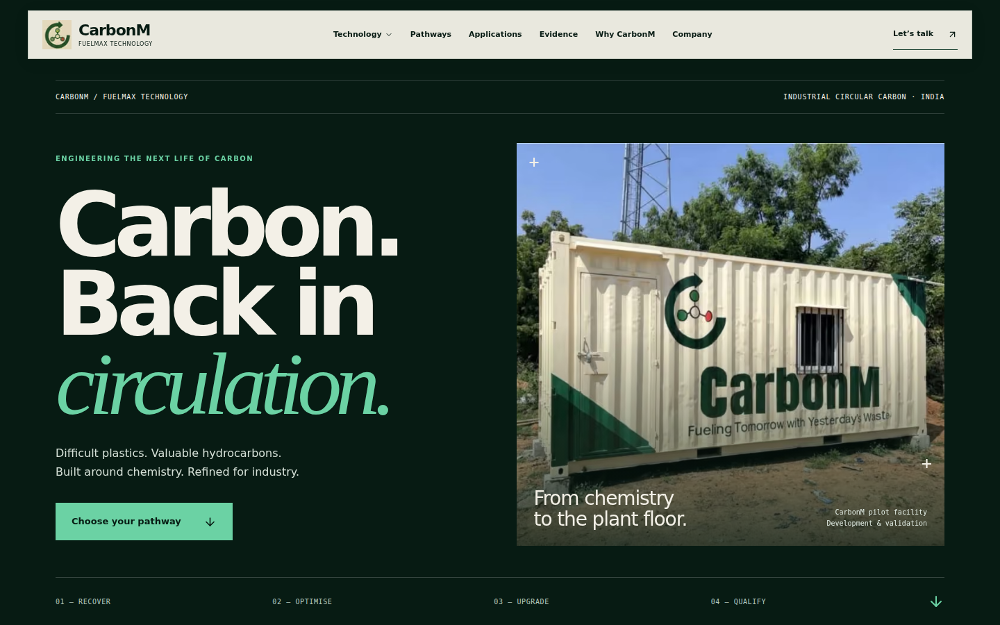
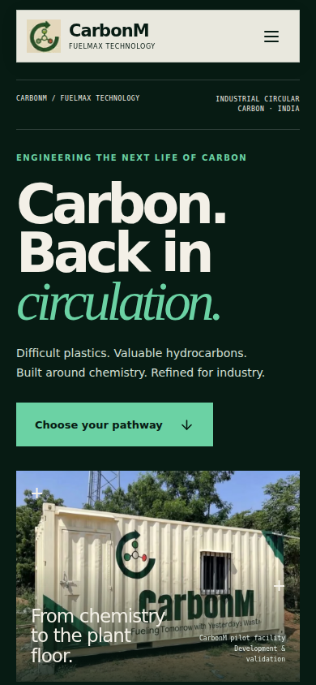
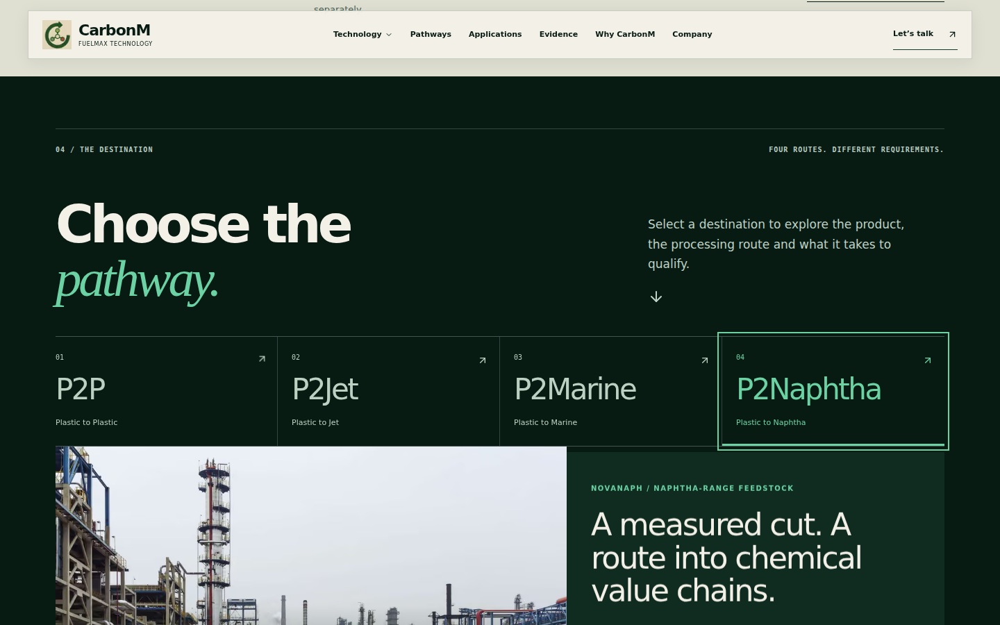
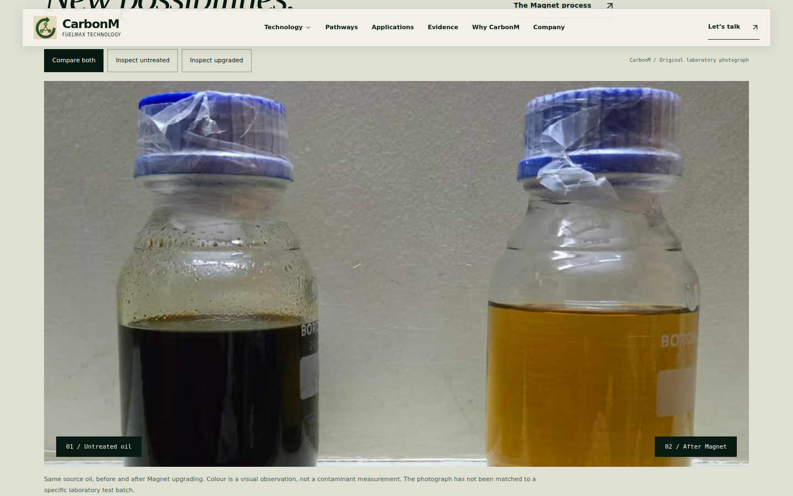

# Browser and engineering review

Status: PASS for engineering/browser regression; draft pending human visual approval. Main remains unchanged.

## Reproducible checks
- `npm ci`: passes after committed lockfile repair, including on GitHub's clean Node 22 runner.
- `npm run typecheck`, `npm run lint`, `npm run build`: pass locally and on CI.
- Chromium regression: `node scripts/visual-smoke.cjs` after installing Playwright and @axe-core/playwright as shown in the workflow.
- Screenshots, JSON report and Playwright trace: GitHub Actions artifact `website-visual-smoke`.

## Failures found and corrected
| Finding | Evidence | Correction |
| --- | --- | --- |
| Old pathway heading had no action; adjacent selector mixed technology/evidence with product routes | Source audit of OutputCarousel.tsx | New four-pathway ARIA tab module, hero anchor, route links and qualification CTAs. Output selector renamed to evidence. |
| Clean dependency install failed | Local npm ci / inconsistent @emnapi lock entries | Reconciled and committed the lockfile; removed CI's mutation workaround. |
| Inherited outputs-page apostrophe lint errors blocked previous branch CI | Base run 89 failed at lint | Escaped/rephrased JSX text. |
| Photo caption inherited dark text over the pilot image | Inspected desktop screenshot from run 93 | Explicit warm-white caption colour. |
| Browser route assertion raced Next client navigation | Run 93 trace/report: selected panel passed, immediate URL assertion failed | Await the actual destination URL and page load before asserting. |
| Local browser/server sockets unavailable; live cloud preview timed out | Command sandbox and cloud-browser failures | Run the full browser regression on a clean GitHub Actions Chromium runner; inspect its screenshots. |

## Initial measurements
Run 93 at 1440×900: visible initial hero; no horizontal overflow; zero automated homepage WCAG A/AA violations; no console/runtime errors before test assertion; observed CLS 0 and LCP 828 ms in that CI environment. These are lab observations, not field/Core Web Vitals guarantees.

Ten inherited photographic sources reduced from 25.60 MB to 3.76 MB (85.3%). New CarbonM originals add approximately 1.25 MB of lossless WebP source data. Next image optimisation supplies responsive display sizes. No external web fonts or continuous smooth-scroll loop added.

## Release requirements
Keep the PR draft until final browser results and visual approval. Confirm inherited image source/licence records before public release. Product/application certification, customer validation and RCF scheme recognition remain separate pending processes. Additional original plant interior, equipment and people-at-work photos are welcome for a later iteration.

## Second browser run (95)
113 checks passed before the 320 px horizontal-overflow assertion. All four pathway routes and CTAs, keyboard selection, all scroll chapter controls, image changes at 01/03/05/06/01, all YieldBoost and Magnet controls, all output selectors, core-route metadata, 1024/768/390 px layouts and the 390 px mobile menu passed. No runtime errors, console errors or failed requests were recorded. The 320 px pathway grid and button/text wrapping have been adjusted for the next run.

## Dependency remediation
The inherited Next 16.3.2 and sharp 0.35.0 lock entries had critical/high advisories. Updated within the current major version, with a fresh install and regression run. Primary advisories: https://github.com/advisories/GHSA-2464-fhr4-w9xw, https://github.com/advisories/GHSA-673q-mjm6-r5xr, https://github.com/advisories/GHSA-wq5f-xc86-pv6w. Final audit status is recorded with the final browser evidence.

Screenshot inspection also found that Next client navigation could retain the deep homepage scroll position on a qualification page. Added an explicit pathway-arrival scroll reset and a browser assertion that the destination heading is in the first viewport. Screenshot capture now waits for visible photographs to finish loading so a lazy-image placeholder is not mistaken for the final layout.

Updated runtime: Next 16.4.6 and sharp 0.35.5. Full local audit: zero critical/high advisories, seven moderate entries in the development lint dependency chain (one minimatch advisory propagated through TypeScript ESLint packages). Production-only audit: {'info': 0, 'low': 0, 'moderate': 0, 'high': 0, 'critical': 0, 'total': 0}. No automatic audit-fix or forced major-version migration was used.

## Final verified run — 97

- Source commit: ef75cc1a09cf011a0d9659bfab9166db8bd749ef.
- [GitHub Actions](https://github.com/carbonmtechnology-decacorn/alkanalyze-web/actions/runs/43886287168): clean install, TypeScript, lint, production build, production dependency audit and Chromium regression passed.
- [Complete evidence artifact](https://github.com/carbonmtechnology-decacorn/alkanalyze-web/actions/runs/43886287168/artifacts/14234737407): 36 original PNG screenshots, JSON reports and Playwright trace. Artifact retention expires 14 February 2027.
- 145 browser assertions passed; desktop 1440×900, tablet/laptop 1024/768 px, mobile 390×844 and narrow 320×844.
- All four pathway selections, routes, email CTA destinations, first-viewport headings, keyboard arrow and End navigation and internal links tested. Six chapter controls and reversible 01→03→05→06→01 image transitions tested. YieldBoost layers, all Magnet inspect modes and all output selectors tested.
- Mobile menu, Escape, desktop keyboard submenu, reduced motion, JavaScript-disabled hero/crawlable pathway links, core-route canonical URLs, legacy redirects and pathway sitemap entries passed.
- Zero automated homepage WCAG A/AA violations. This automated check plus manual visual/keyboard checks is not an accessibility certification or a full assistive-technology audit.
- Zero page/runtime errors, console errors or failed requests recorded.
- Production-only dependency audit: zero vulnerabilities; full audit retains seven moderate lint-tool dependency entries.
- Observed CI desktop CLS 0; LCP 880 ms. These are unthrottled lab observations, not field-performance guarantees.

## Reviewed screenshot gallery

The following are losslessly encoded copies of the final Chromium PNG screenshots, with no layout, colour or content edits.

The source remains on `website/nov2026-cinematic`, targeting `website/nov2026-positioning-performance` in draft PR #2. Existing draft PR #1 and main were verified unchanged.
